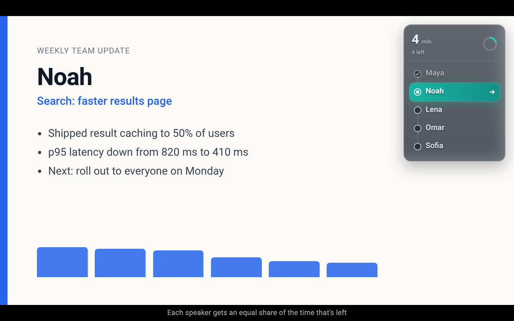
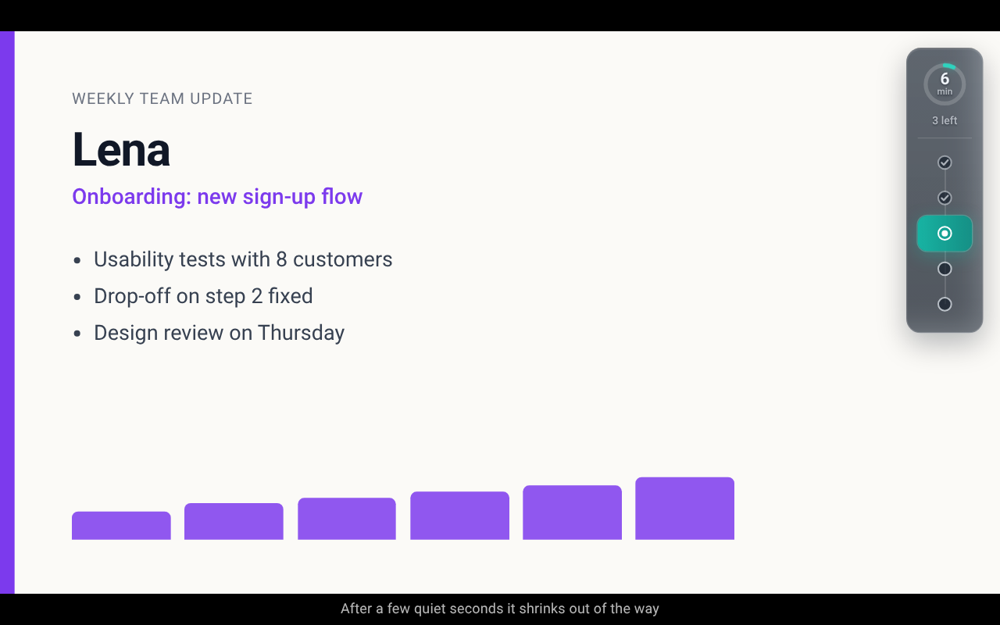
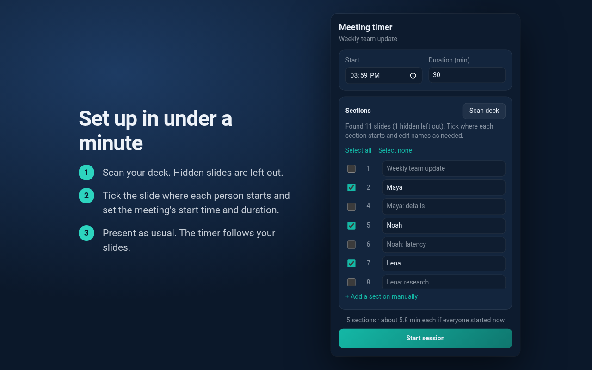

# Meeting Timer Overlay

A Chrome extension that keeps a round of updates fair. While you present a Google Slides deck,
a calm card in the corner shows a countdown for whoever is presenting and the list of everyone
who's up, so the whole room can see whose turn it is and how much time is left.



- [Features](#features)
- [How time is split](#how-time-is-split)
- [Install](#install)
- [Running a meeting](#running-a-meeting)
- [Privacy and permissions](#privacy-and-permissions)
- [How it works](#how-it-works)
- [Limitations](#limitations)
- [Development](#development)
- [Publishing to the Chrome Web Store](#publishing-to-the-chrome-web-store)
- [Troubleshooting](#troubleshooting)

## Features

- **A calm countdown** in whole minutes. No seconds tick, so it never feels like an alarm.
- **Every section in slide order.** Finished sections are checked, the current one is
  highlighted with an arrow, and upcoming ones wait. The card also says how many are left.
- **A gentle limit.** When a turn runs out, the card turns amber and says "Wrap up". More than a minute over, it counts those minutes with a minus sign, in red, and the number fades slowly in and out.
- **Stays out of the way.** After 5 seconds without a slide change, the card shrinks to a slim
  strip with the minutes, the sections left, and one dot per section. The next slide change
  brings the full card back.

  

- **Readable on any slide.** The card is see-through, but it blurs and darkens what's behind
  it, so the text stays readable on white, black, or busy slides.
- **Follows your slides.** You never touch the timer during the meeting: a turn starts when you
  reach the slide where that person's part begins.
- **Presenter-friendly.** The overlay never takes focus or clicks, so you keep clicking or
  using the arrow keys to change slides. It works in fullscreen.

## How time is split

Each section gets an equal share of the time that's actually left when it begins:

```
time for this section = (start time + duration - now) / sections left
```

With 22 minutes left and 5 sections, the first person gets 22 / 5 = 4.4 minutes (shown as
"4 min"). If they finish after 2 minutes, the next person gets 20 / 4 = 5 minutes. Short
updates give time back to everyone after them, and long ones take it from the people still
waiting.

A section reached before the meeting's start time holds its full share until the meeting
starts. Times always come from the wall clock, so a throttled background tab never drifts.

## Install

**From the Chrome Web Store:** _(link once published)_

**From source** (no build step):

1. Clone this repository.
2. Open `chrome://extensions` and turn on **Developer mode**.
3. Click **Load unpacked** and select the `extension/` folder.

**On another computer**, run `npm run build`, copy `dist/meeting-timer-overlay-<version>.zip`,
unzip it, and load the unzipped folder the same way.

## Running a meeting



1. Open the deck in the Google Slides editor and click the extension's toolbar icon.
2. Click **Scan deck**. The extension lists every slide's title and leaves out hidden
   (skipped) slides. Slide numbers match the editor's filmstrip and the slideshow, so they jump
   over hidden slides.
3. Tick the slide where each section starts (for example, each person's first slide).
   **Select all** and **Select none** help when most or few slides start a section. Edit the
   names if needed. Slides after a ticked slide belong to that section. If the scan fails, use
   **+ Add a section manually**.
4. Set the meeting's start time and duration in minutes, then click **Start session**. The
   toolbar icon shows an `ON` badge.
5. Present as usual. The next turn starts when you reach the next ticked slide. Moving back
   through slides, or through a section's other slides, leaves the current turn as it is.
   Jumping ahead marks the skipped sections as done. `Alt+Shift+P` returns to the previous
   section and splits the time still left among the sections from that one on.
6. Click **Stop** in the popup when you're done. The overlay disappears.

The setup (ticks, names, start time, and duration) is saved per presentation, so next week you
only rescan and adjust. Rescanning keeps your ticks and edited names, matched by slide ID.

### Keyboard shortcuts

These work while the slides have focus, including in fullscreen. Change them at
`chrome://extensions/shortcuts`.

| Shortcut      | Action                                                        |
| ------------- | ------------------------------------------------------------- |
| `Alt+Shift+N` | Advance to the next section manually                          |
| `Alt+Shift+P` | Return to the previous section and recalculate the time left |
| `Alt+Shift+O` | Show or hide the overlay                                      |

The popup offers the same controls, plus **Stop**.

## Privacy and permissions

The extension has no servers, accounts, analytics, or remote code. Slide titles and settings
stay in `chrome.storage.local` on your device. See [PRIVACY.md](PRIVACY.md) for the full
policy.

| Permission                         | Why                                                                                         |
| ---------------------------------- | ------------------------------------------------------------------------------------------- |
| `storage`                          | Saves each deck's setup and the running session, shared by the popup, shortcuts, and overlay |
| Content script on `docs.google.com/*` | Draws the overlay, detects the current slide, and reads slide titles when you scan        |

The content script matches all of `docs.google.com/*` rather than just `/presentation/*`
because Slides runs its slideshow in `about:blank` frames and windows. Following those requires
`match_origin_as_fallback`, which Chrome only allows with a `/*` path. On pages that aren't a
Slides presentation, the script exits immediately.

## How it works

| File                               | Role                                                                     |
| ---------------------------------- | ------------------------------------------------------------------------ |
| `extension/src/schedule.js`        | Session model, the fair time split, and what the overlay shows           |
| `extension/src/slide_dom.js`       | All Google Slides page knowledge: deck scanning and slide detection      |
| `extension/src/overlay.js`         | The Shadow DOM card, its transitions, compact mode, and fullscreen handling |
| `extension/src/content.js`         | Ties storage, slide tracking, and the overlay together in Slides frames  |
| `extension/src/service_worker.js`  | Keyboard shortcuts and the toolbar badge                                 |
| `extension/popup/`                 | Setup and session controls                                               |

The active session lives in `chrome.storage.local`. Every Slides frame reads it, and whichever
frame shows the presentation advances it.

**Scanning** fetches two views of the open presentation from `docs.google.com` with your
existing session: `/htmlpresent` (Google's accessible HTML view) for slide titles, and
`/present` (the slideshow page), whose embedded slide list flags each slide as shown or
skipped. A slide's title is its most prominent text: the largest font, then the highest on
the slide. The popup parses the HTML, because Slides pages enforce Trusted Types.

**Slide detection** in the slideshow uses, in order: the slide ID in the viewer's address, the
navbar's slide position, and the slide's accessibility label.

**The overlay** lives in a closed Shadow DOM with `pointer-events: none`, so the page's styles
can't break it and clicks pass through to the slides. In fullscreen it moves into the
fullscreen element, because anything outside it is hidden.

## Limitations

Google Slides has no API for this without OAuth, so the extension relies on Slides' page
structure:

- Slide titles are a heuristic (largest, then highest text), so check the suggested names.
- If the slideshow's slide list can't be read, hidden slides aren't left out of the scan.
- Speaker-notes (Presenter view) windows are ignored on purpose. The overlay appears on the
  audience-facing slideshow.
- If Google changes its markup, scanning fails with a message. You can still add sections
  manually and move turns with `Alt+Shift+N` and `Alt+Shift+P`.

## Development

Requirements: [Node.js](https://nodejs.org/) 20 or later. Rendering store images also needs
Chrome or Chromium. The project has **no npm dependencies**: every script uses Node's standard
library, so there's nothing to install.

```bash
npm test               # unit tests (Node's built-in test runner)
npm run build          # validate the manifest and write dist/meeting-timer-overlay-<version>.zip
npm run check          # both of the above
npm run icons          # redraw extension/icons/*.png
npm run store-assets   # re-render store/assets/*.png with headless Chrome
```

After editing the extension, click the reload icon on its card in `chrome://extensions` and
refresh open Slides tabs.

### Project layout

```
extension/            Exactly what ships: manifest, scripts, popup, icons
tests/                Unit tests for the time split, Slides parsing, and the build helpers
scripts/
  build.mjs           Manifest checks against store limits, then a reproducible zip
  make-icons.mjs      Draws the icon at 16, 32, 48, and 128 px (no image tools needed)
  store-assets.mjs    Renders screenshots and promo tiles through Chrome's DevTools protocol
  lib/                CRC-32, PNG, zip, and manifest helpers
store/
  listing.md          Every Chrome Web Store field, ready to paste
  assets/             Screenshots and promo tiles
  templates/          The page those images are rendered from, using the real overlay and popup
PRIVACY.md            Privacy policy (link it in the store listing)
CHANGELOG.md          Release notes
```

### Tests

`npm test` covers the time split (including the 22 / 5, then 20 / 4 example), turn handling
(going back, jumping ahead, finishing), the compact view, slide-title extraction, hidden-slide
detection against a captured Slides page, slide detection fallbacks, the manifest checks, and
the zip writer. Overlay visuals are checked by eye: load the extension and present a deck, or
run `npm run store-assets` and look at `store/assets/`.

### Store images

`store/templates/stage.html` builds each scene with the extension's real `schedule.js`,
`overlay.js`, and popup (with Chrome's extension APIs stubbed), so the screenshots always match
the current design. `npm run store-assets` serves the repository on localhost, opens each scene
in headless Chrome, and checks every image has the exact size the store requires. If Chrome
isn't found, set `CHROME_PATH`:

```bash
CHROME_PATH="/Applications/Google Chrome.app/Contents/MacOS/Google Chrome" npm run store-assets
```

## Publishing to the Chrome Web Store

### One-time setup

1. Sign in to the [Chrome Web Store Developer Dashboard](https://chrome.google.com/webstore/devconsole)
   with the Google account that will own the listing. A dedicated account (or a group
   publisher) makes it easier to hand over later.
2. Pay the one-time US$5 registration fee and accept the developer agreement.
3. Turn on 2-Step Verification for the account. The store requires it to publish.
4. In **Account**, set and verify a contact email, and complete the trader / non-trader
   declaration (required for listings shown in the EU). A free personal project is usually
   non-trader.
5. Publish this repository (for example on GitHub) so the privacy policy, homepage, and
   support links in the listing are public.

### Preparing a release

1. Update `version` in `extension/manifest.json`. Every upload must have a higher version than
   the last one.
2. Add the release to `CHANGELOG.md`.
3. Run `npm run check`.
4. If the overlay or popup changed, run `npm run store-assets` and review `store/assets/`.
5. Load `extension/` unpacked and run through a meeting on a real deck: scan, start, present,
   advance, wait for compact mode, and stop.

### First submission

1. In the dashboard, click **New item** and upload `dist/meeting-timer-overlay-<version>.zip`.
2. Fill in the **Store listing**, **Privacy**, **Distribution**, and **Test instructions**
   tabs from [store/listing.md](store/listing.md). It has every text field and maps each image
   to its file.
3. Click **Submit for review**. Reviews usually take a few days; you'll get an email. Chrome
   suggests leaving "Publish automatically after review" on unless you want to time the launch.

### Updates

1. Prepare the release as above.
2. In the dashboard, open the item, go to **Package**, click **Upload new package**, and upload
   the new zip.
3. Update the listing text or images if they changed, then **Submit for review**.

Users get the update automatically within a few hours of approval.

### Common rejection reasons to avoid

- **Permissions without justification.** The text for each one is in `store/listing.md`.
- **Undisclosed data handling.** Keep the Privacy tab and `PRIVACY.md` in sync with what the
  code does if you add features.
- **Misleading branding.** Keep "for Google Slides" wording and the non-affiliation note; don't
  use Google's logos in the icon or images.
- **Remote code.** Never load scripts from the network; Manifest V3 forbids it.

## Troubleshooting

| Problem                                     | Fix                                                                                       |
| ------------------------------------------- | ----------------------------------------------------------------------------------------- |
| The popup says to open a Slides presentation | Open the deck in the editor (`/edit`) in the active tab, then reopen the popup.          |
| "Scan failed"                               | Reload the Slides tab and retry. If it keeps failing, add sections manually.             |
| The overlay doesn't appear in the slideshow | Check the toolbar badge says `ON`, then press `Alt+Shift+O` in case the overlay is hidden. |
| The turn doesn't advance                    | Check the right slides are ticked; press `Alt+Shift+N` to advance manually.               |
| Nothing works after updating the extension  | Refresh the Slides tab so it picks up the new content script.                             |

## License

[MIT](LICENSE). Meeting Timer Overlay is an independent project and isn't affiliated with or
endorsed by Google. Google Slides is a trademark of Google LLC.
